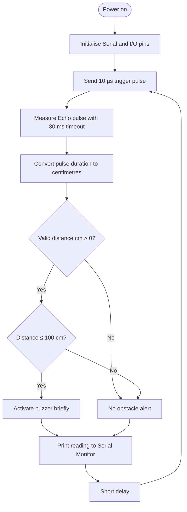

<!--
  Third Hand-Eye — Arduino ultrasonic obstacle-alert prototype
  Keep this README aligned with the firmware and hardware actually present in this repository.
-->

<div align="center">


<br>

# 🦯 Third Hand-Eye

### An Arduino-based ultrasonic obstacle-alert prototype

<p>
  <em>Sense nearby objects · Estimate distance · Trigger an audible alert</em>
</p>

<p>
  <a href="https://github.com/Supriyo016/Arduino-Uno-Third-Hand-Eye-Project-for-Visually-Impaired-Individuals/actions/workflows/ci.yml">
    
  </a>
  
  
  
  
  
</p>

<p>
  <a href="#-quick-navigation">Explore README</a> ·
  <a href="#-watch-the-demonstration">Watch demo</a> ·
  <a href="#-build-and-upload">Build the project</a> ·
  <a href="docs/project-report.pdf">Read project report</a>
</p>

<p>
  <strong>Designed and developed by <a href="https://github.com/Supriyo016">Supriyo Sarkar</a></strong>
</p>

<p>
  <a href="https://developerbro.vercel.app">DeveloperBro</a> ·
  <a href="https://tour-india-pi.vercel.app">Tour India</a>
</p>

</div>

---

> [!IMPORTANT]
> **Safety notice — educational prototype only.** This project is not a certified mobility aid and must not replace a white cane, guide dog, human assistance, or established mobility practices. It detects only some objects within the ultrasonic sensor's field of view. It cannot reliably detect stairs, holes, drop-offs, all surface types, or every obstacle. Never depend on it for independent navigation or safety-critical decisions.

## 📚 Quick navigation

| Section | What you will find |
|---|---|
| [Project overview](#-project-overview) | Purpose, operating idea and current capabilities |
| [How it works](#-how-it-works) | Signal flow, distance formula and alert condition |
| [Hardware](#-hardware-and-connections) | Components, pin mapping and circuit diagram |
| [Build and upload](#-build-and-upload) | Arduino IDE and Arduino CLI instructions |
| [Testing](#-testing-and-continuous-integration) | Host-side unit tests and GitHub Actions |
| [Repository structure](#-repository-structure) | Source files and project resources |
| [Demo and report](#-watch-the-demonstration) | Video demonstration and project report |
| [Limitations](#-limitations-and-safety) | Known constraints and future work |

---

## ✨ Project overview

**Third Hand-Eye** is a small embedded-systems prototype built with an **Arduino Uno**, an **HC-SR04 ultrasonic distance sensor**, and an **active buzzer**.

The sensor sends an ultrasonic pulse and measures the time taken for its echo to return. The Arduino converts that time into an approximate distance. When a valid reading is **greater than 0 cm and less than or equal to 100 cm**, the firmware activates the buzzer briefly.

The measured value is also sent to the Serial Monitor at 9600 baud. This makes it possible to observe readings while testing the circuit.

### What the current prototype does

<div align="center">
<table>
  <tr>
    <td align="center" width="25%">
      <h2>📡</h2>
      <strong>Measure</strong><br>
      <sub>HC-SR04 echo timing</sub>
    </td>
    <td align="center" width="25%">
      <h2>🧮</h2>
      <strong>Calculate</strong><br>
      <sub>Approximate distance in cm</sub>
    </td>
    <td align="center" width="25%">
      <h2>🎯</h2>
      <strong>Compare</strong><br>
      <sub>100 cm alert threshold</sub>
    </td>
    <td align="center" width="25%">
      <h2>🔔</h2>
      <strong>Alert</strong><br>
      <sub>Brief audible buzzer pulse</sub>
    </td>
  </tr>
</table>
</div>

### Current implementation at a glance

| Parameter | Implemented value |
|---|---|
| Microcontroller | Arduino Uno |
| Distance sensor | HC-SR04 |
| Alert output | Active buzzer |
| Trigger pin | D12 |
| Echo pin | D10 |
| Buzzer pin | D5 |
| Alert threshold | 100 cm |
| Echo timeout | 30,000 microseconds (30 ms) |
| Serial output | 9600 baud |
| Distance unit | Centimetres |
| Host-side test standard | C++17 |

> [!NOTE]
> The 100 cm value is a firmware threshold, not a guaranteed detection distance. Actual sensor performance depends on object size, surface, angle, mounting, environment, and power conditions.

---

## 🧠 How it works

The firmware follows a repeated sensing and feedback cycle.

<div align="center">
  
  
  
  
  
</div>



### 1. Trigger the ultrasonic sensor

The Arduino sets the trigger pin LOW briefly, sends a HIGH pulse for 10 microseconds, and then sets it LOW again. The HC-SR04 responds by transmitting an ultrasonic burst.

### 2. Measure the echo

The firmware uses `pulseIn()` to measure the HIGH duration on the echo pin. The wait is limited to **30 ms** so that the program does not wait indefinitely when no echo is received.

### 3. Convert time into distance

The helper function in `firmware/third_hand_eye/distance.h` converts the echo duration into an approximate distance:

```cpp
distance_cm = echo_microseconds / 29 / 2;
```

The division by two accounts for the sound travelling to the object and then returning to the sensor.

A zero or negative duration is treated as **no valid echo** and returns zero. It is not treated as a detected obstacle.

### 4. Decide whether to alert

The alert helper uses this condition:

```cpp
cm > 0 && cm <= alertRangeCm
```

The current firmware sets:

```cpp
const long ALERT_RANGE_CM = 100;
```

When the condition is true, the buzzer is set HIGH for approximately 100 ms and then switched LOW. The firmware prints the distance reading to the Serial Monitor.

---

## 🔌 Hardware and connections

### Required components

| Component | Quantity | Purpose |
|---|:---:|---|
| Arduino Uno | 1 | Main microcontroller |
| HC-SR04 ultrasonic sensor | 1 | Measures echo time for distance estimation |
| Active buzzer module | 1 | Audible alert |
| Jumper wires | As required | Connects the modules |
| USB cable | 1 | Programming and test power |
| Suitable external power source | Optional | Depends on the final prototype setup |

### Pin connection table

| Module | Module pin | Arduino Uno pin |
|---|---|---|
| HC-SR04 | VCC | 5V |
| HC-SR04 | GND | GND |
| HC-SR04 | TRIG | D12 |
| HC-SR04 | ECHO | D10 |
| Active buzzer | Signal (+) | D5 |
| Active buzzer | GND (−) | GND |

<div align="center">
  <h3>📐 Circuit connection diagram</h3>
  
  <br>
  <sub>Use the diagram together with the pin table. Verify the labels on your physical modules before powering the circuit.</sub>
</div>

> [!WARNING]
> **Electrical safety:** Check the buzzer module's voltage and current requirements. Do not drive a bare buzzer directly from an Arduino GPIO if its current exceeds the pin's safe operating limit; use a suitable transistor or driver circuit. Confirm the power supply polarity and wiring before connecting the board. Do not assume that every 9 V battery connector or buzzer module is wired identically.

---

## 🚀 Build and upload

You can compile and upload the firmware using either the Arduino IDE or Arduino CLI.

### Prerequisites

- Arduino Uno board
- HC-SR04 sensor and buzzer connected according to the pin table
- USB data cable
- Arduino IDE or Arduino CLI
- Arduino AVR board core

### Option A — Arduino IDE

1. Clone or download this repository.
2. Open `firmware/third_hand_eye/third_hand_eye.ino` in Arduino IDE.
3. Select **Tools → Board → Arduino AVR Boards → Arduino Uno**.
4. Select the correct serial port under **Tools → Port**.
5. Click **Upload**.
6. Open **Tools → Serial Monitor** and select **9600 baud**.

### Option B — Arduino CLI

Install the Arduino AVR core:

```bash
arduino-cli core update-index
arduino-cli core install arduino:avr
```

Compile the sketch:

```bash
arduino-cli compile --fqbn arduino:avr:uno firmware/third_hand_eye
```

Upload it to the connected board (replace `<PORT>` with the correct serial port):

```bash
arduino-cli upload --fqbn arduino:avr:uno -p <PORT> firmware/third_hand_eye
```

### Check the output

Open the Serial Monitor at **9600 baud**. The firmware prints distance values in centimetres.

For a controlled bench test, place a suitable flat object in front of the sensor and move it slowly. Compare the serial readings with a ruler or measuring tape. Check whether the buzzer activates when a valid measurement falls within the configured threshold.

Do not use this experiment as a test of real-world mobility safety.

---

## 🧪 Testing and continuous integration

The distance conversion and alert predicate are kept in `distance.h` as simple C++ functions without Arduino-specific dependencies. This makes the core logic testable on a normal computer.

### Run host-side tests

Install a C++ compiler such as g++, then run:

```bash
g++ -std=c++17 -Wall -Wextra -Werror tests/test_distance.cpp -o test_distance
./test_distance
```

Expected successful output:

```text
all distance tests passed
```

### Covered test cases

| Test | Expected behaviour |
|---|---|
| Zero echo duration | Returns 0 cm |
| Negative duration | Returns 0 cm |
| 58 microseconds | Converts to 1 cm |
| 5,800 microseconds | Converts to 100 cm |
| 29,000 microseconds | Converts to 500 cm |
| 0 cm reading | Does not trigger the buzzer |
| 1 cm reading | Triggers the alert predicate |
| 100 cm reading | Triggers the alert predicate |
| 101 cm reading | Does not trigger the alert predicate |

### GitHub Actions checks

The workflow at `.github/workflows/ci.yml` runs three jobs:

- **Host unit tests:** compiles and runs the C++17 distance tests.
- **Arduino sketch compilation:** checks that the firmware compiles for `arduino:avr:uno`.
- **Markdown link checking:** checks links in the README.

<p align="center">
  <a href="https://github.com/Supriyo016/Arduino-Uno-Third-Hand-Eye-Project-for-Visually-Impaired-Individuals/actions">
    
  </a>
</p>

---

## 🗂️ Repository structure

```text
Arduino-Uno-Third-Hand-Eye-Project/
│
├── .github/
│   └── workflows/
│       └── ci.yml
│
├── assets/
│   ├── banner.svg
│   └── circuit-diagram.png
│
├── docs/
│   ├── demo-480p.mp4
│   └── project-report.pdf
│
├── firmware/
│   └── third_hand_eye/
│       ├── third_hand_eye.ino
│       └── distance.h
│
├── tests/
│   └── test_distance.cpp
│
└── README.md
```

### Key source files

| File | Responsibility |
|---|---|
| `third_hand_eye.ino` | Arduino setup, sensor trigger, echo measurement, buzzer output and serial logging |
| `distance.h` | Arduino-independent distance conversion and alert predicate |
| `test_distance.cpp` | Host-side tests for conversion and alert boundaries |
| `ci.yml` | Automated unit test, sketch compilation and README link validation |
| `circuit-diagram.png` | Hardware wiring reference |
| `project-report.pdf` | Detailed project documentation |

---

## 🎥 Watch the demonstration

<div align="center">
  <a href="https://www.youtube.com/watch?v=xSJj8tTnAgg">
    
  </a>
  <br>
  <strong>▶ Select the thumbnail to watch the demonstration on YouTube</strong>
  <br><br>
  <a href="docs/demo-480p.mp4">
    
  </a>
</div>

---

## 📄 Project report and resources

| Resource | Open |
|---|---|
| Complete source repository | [GitHub repository](https://github.com/Supriyo016/Arduino-Uno-Third-Hand-Eye-Project-for-Visually-Impaired-Individuals) |
| Arduino firmware | [Open sketch](firmware/third_hand_eye/third_hand_eye.ino) |
| Distance helper | [Open distance.h](firmware/third_hand_eye/distance.h) |
| Circuit wiring | [View circuit diagram](assets/circuit-diagram.png) |
| Project documentation | [Open project report](docs/project-report.pdf) |
| Video | [Watch YouTube demonstration](https://www.youtube.com/watch?v=xSJj8tTnAgg) |
| Automated checks | [View GitHub Actions](.github/workflows/ci.yml) |

---

## ⚠️ Limitations and safety considerations

This implementation is a learning prototype. A single forward-facing HC-SR04 sensor and a buzzer do not provide the coverage or reliability required for a dependable mobility aid.

| Limitation | Why it matters |
|---|---|
| Limited sensing direction | Objects outside the sensor's field of view may not be detected. |
| Surface and angle sensitivity | Soft, angled, narrow, or irregular objects may return weak or unreliable echoes. |
| No drop-off detection | The current design does not reliably detect stairs, holes, or changes in ground level. |
| No object classification | It cannot identify an object's type, height, motion, or whether a path is safe. |
| Audible-only output | The current firmware does not implement vibration or tactile feedback. |
| No validated safety redundancy | A missed echo or incorrect measurement must not be interpreted as a safe path. |
| Environmental variation | Mounting, temperature, nearby surfaces, and electrical noise can affect readings. |

A real assistive product would need much more than a working sensor and buzzer. It would require carefully designed sensor coverage, fail-safe behaviour, redundant sensing, a safe enclosure and power system, extensive reliability testing, accessibility research, user trials, and applicable regulatory assessment.

**Do not use this prototype as a replacement for established mobility tools or assistance.**

---

## 🔭 Future development roadmap

The following are ideas for future work; they are **not implemented features** in the current firmware.

- [ ] Add a vibration motor with a suitable driver circuit and safe tactile feedback.
- [ ] Evaluate distance-dependent alert patterns with user testing.
- [ ] Study multi-sensor placement and blind-spot reduction.
- [ ] Improve filtering, calibration, and invalid-echo handling.
- [ ] Design a wearable enclosure with secure mounting and power management.
- [ ] Add structured hardware-in-the-loop and environmental tests.
- [ ] Conduct supervised usability and reliability evaluations.
- [ ] Document a safety case before any real-world assistive use is considered.

---

## 👨‍💻 Author and project links

<div align="center">

<a href="https://github.com/Supriyo016">
  
</a>

<br><br>

<a href="https://github.com/Supriyo016">
  
</a>
<a href="https://www.linkedin.com/in/supriyo-sarkar/">
  
</a>
<a href="mailto:supriyo.sarkar016@gmail.com">
  
</a>

<br><br>

<sub>Computer Science & Engineering · Embedded Systems · Assistive Technology</sub>

<br>

<sub>Explore more: <a href="https://developerbro.vercel.app">DeveloperBro Academic Portfolio</a> · <a href="https://tour-india-pi.vercel.app">Tour India</a></sub>

</div>

---

<div align="center">

**⭐ Found this project useful?** Consider starring the repository.

<sub>Built as an educational embedded-systems prototype. Verify the circuit and test in a controlled environment.</sub>

<br><br>


</div>
