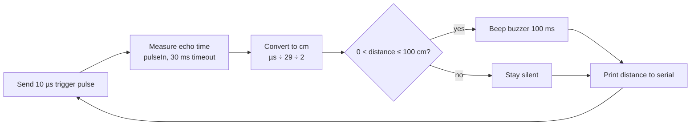

<p align="center"></p>

<p align="center">
<a href="https://github.com/Supriyo016/Arduino-Uno-Third-Hand-Eye-Project-for-Visually-Impaired-Individuals/actions/workflows/ci.yml"></a>


</p>

# Third Hand-Eye: obstacle alert for visually impaired users

A low-cost wearable aid built on an Arduino Uno. An HC-SR04 ultrasonic sensor measures the distance to whatever is in front of the user, and a buzzer beeps when something is within **100 cm**. The distance is also printed over serial for debugging.

▶️ [Demonstration video (YouTube)](https://www.youtube.com/watch?v=xSJj8tTnAgg) · 📄 [Project report (PDF)](docs/project-report.pdf) · 🎞️ [Short demo clip](docs/demo-480p.mp4)

## How it works



## Hardware

| Part | Qty | Arduino pin |
|---|---:|---|
| Arduino Uno | 1 | — |
| HC-SR04 ultrasonic sensor | 1 | Trig → D12, Echo → D10, VCC → 5V, GND → GND |
| Active buzzer | 1 | Signal → D5, GND → GND |
| Jumper wires, 9 V battery + clip | — | Barrel jack |

<p align="center"></p>

## Build and upload

With the Arduino IDE: open `firmware/third_hand_eye/third_hand_eye.ino`, choose **Arduino Uno**, upload.

With `arduino-cli`:

```bash
arduino-cli core install arduino:avr
arduino-cli compile --fqbn arduino:avr:uno firmware/third_hand_eye
arduino-cli upload  --fqbn arduino:avr:uno -p <PORT> firmware/third_hand_eye
```

Open the serial monitor at 9600 baud to see the measured distance.

## Tests

The distance conversion and alert rule live in `firmware/third_hand_eye/distance.h` with no Arduino dependency, so they are tested on a PC:

```bash
g++ -std=c++17 -Wall -Wextra tests/test_distance.cpp -o test_distance && ./test_distance
```

CI runs these tests, compiles the sketch for the Uno with `arduino/compile-sketches`, and checks README links.

## Project structure

```
firmware/third_hand_eye/   sketch (.ino) and testable helpers (distance.h)
tests/                     host-side unit tests
assets/                    banner and circuit diagram
docs/                      project report and demo clip
```

## Limitations and next steps

- One forward-facing sensor: obstacles at head or ground level outside its ~15° cone are missed.
- HC-SR04 readings are unreliable on soft or angled surfaces.
- Possible improvements: vibration motor instead of a buzzer, beep rate proportional to distance, a second sensor for drop-offs, and a rechargeable battery pack.

## Author

**Supriyo Sarkar** · [GitHub](https://github.com/Supriyo016) · [LinkedIn](https://www.linkedin.com/in/supriyo-sarkar/) · [Portfolio](https://developerbro.vercel.app)
