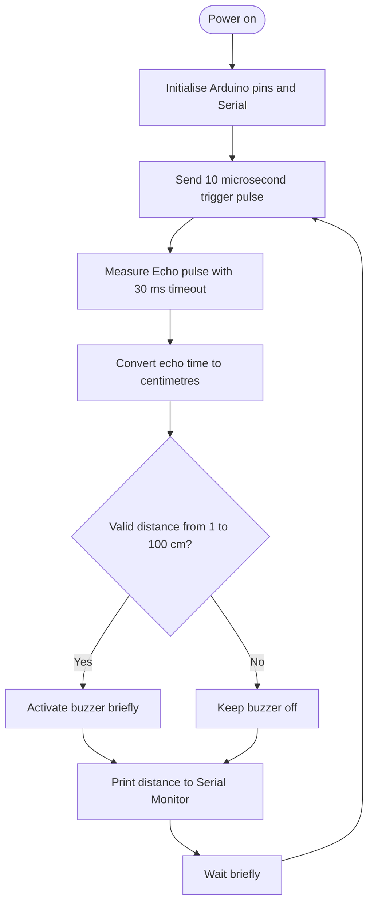
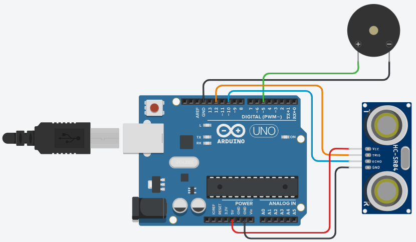

<div align="center">



<p>
  
  
  
  
</p>

<a href="https://github.com/Supriyo016/Arduino-Uno-Third-Hand-Eye-Project-for-Visually-Impaired-Individuals/actions/workflows/ci.yml"></a>
<a href="https://github.com/Supriyo016/Arduino-Uno-Third-Hand-Eye-Project-for-Visually-Impaired-Individuals/stargazers"></a>
<a href="https://github.com/Supriyo016/Arduino-Uno-Third-Hand-Eye-Project-for-Visually-Impaired-Individuals/network/members"></a>

<h1>🦯 Third Hand-Eye</h1>
<h3>An Arduino-based ultrasonic obstacle-alert prototype</h3>

<p><strong>Sense nearby obstacles. Give an audible warning. Keep the build simple.</strong></p>

<p>
  <a href="https://www.youtube.com/watch?v=xSJj8tTnAgg"><strong>▶ Watch Demo</strong></a>
  &nbsp;·&nbsp;
  <a href="docs/project-report.pdf"><strong>📄 Read Project Report</strong></a>
  &nbsp;·&nbsp;
  <a href="#-build-and-upload"><strong>⚙️ Build Guide</strong></a>
</p>

</div>

---

## 📌 Project Overview

**Third Hand-Eye** is a small assistive-technology prototype built using an **Arduino Uno**, an **HC-SR04 ultrasonic distance sensor**, and an **active buzzer**.

The sensor measures the distance to objects in front of it. When a valid measurement is **100 cm or less**, the Arduino briefly activates the buzzer. The measured distance is also sent to the Serial Monitor for debugging.

The project demonstrates a simple feedback loop using embedded hardware:

- **Detect:** send an ultrasonic trigger pulse and measure the echo.
- **Calculate:** convert echo time into an approximate distance in centimetres.
- **Alert:** activate the buzzer when an obstacle is detected within the configured range.
- **Monitor:** print the measurement through serial communication.

> **Important:** This is an educational prototype, not a certified mobility aid. It detects only objects within the sensor's field of view and cannot reliably identify every hazard. It must not replace a white cane, guide dog, human assistance, or other established mobility methods.

## ✨ Key Features

<div align="center">
<table>
  <tr>
    <td align="center" width="50%">
      <h3>📡 Ultrasonic sensing</h3>
      <sub>HC-SR04 distance measurement using echo timing</sub>
    </td>
    <td align="center" width="50%">
      <h3>🔔 Audible alert</h3>
      <sub>Active buzzer warning at or below 100 cm</sub>
    </td>
  </tr>
  <tr>
    <td align="center" width="50%">
      <h3>🖥️ Serial monitoring</h3>
      <sub>Live distance output at 9600 baud</sub>
    </td>
    <td align="center" width="50%">
      <h3>🧪 Testable logic</h3>
      <sub>Distance conversion and alert rules tested on a PC</sub>
    </td>
  </tr>
</table>
</div>

## ⚙️ How It Works

The HC-SR04 receives a short trigger pulse, emits an ultrasonic burst and raises its Echo pin for the time taken by the sound to travel to an object and return.



### Distance calculation

The firmware uses the approximate speed of sound conversion implemented in `distance.h`:

[
\text{Distance (cm)} \approx \frac{\text{Echo duration (µs)}}{29 \times 2}
]

The division by two accounts for the sound travelling to the object and back. A zero or timed-out echo is treated as **no valid measurement** and does not trigger the buzzer.

### Alert condition

```cpp
cm > 0 && cm <= 100
```

The threshold is defined by `ALERT_RANGE_CM` in the Arduino sketch and can be changed for experimentation.

## 🔌 Hardware Requirements

| Component | Quantity | Purpose |
|---|:---:|---|
| Arduino Uno | 1 | Main microcontroller |
| HC-SR04 ultrasonic sensor | 1 | Measures forward distance |
| Active buzzer | 1 | Audible obstacle alert |
| Jumper wires | As needed | Electrical connections |
| 9V battery with suitable clip / supply | 1 | Prototype power source |

### Wiring connections

| Component pin | Arduino Uno pin |
|---|---|
| HC-SR04 VCC | 5V |
| HC-SR04 GND | GND |
| HC-SR04 TRIG | D12 |
| HC-SR04 ECHO | D10 |
| Active buzzer signal (+) | D5 |
| Active buzzer GND (−) | GND |

<div align="center">



<sub>Hardware connection reference</sub>

</div>

> Check the pin labels and voltage requirements of your exact buzzer module before connecting it. Do not connect a bare buzzer that exceeds an Arduino pin's current rating directly to the pin; use a suitable driver circuit where required.

## 🚀 Build and Upload

### 1. Prepare the environment

Install the **Arduino IDE** or Arduino CLI and connect your Arduino Uno to the computer using USB.

### 2. Upload using Arduino IDE

1. Open `firmware/third_hand_eye/third_hand_eye.ino`.
2. Select **Tools → Board → Arduino AVR Boards → Arduino Uno**.
3. Select the correct serial port.
4. Click **Upload**.

### 3. Upload using Arduino CLI

Install the Uno board core:

```bash
arduino-cli core update-index
arduino-cli core install arduino:avr
```

Compile the sketch:

```bash
arduino-cli compile --fqbn arduino:avr:uno firmware/third_hand_eye
```

Upload it (replace `<PORT>` with your board's serial port):

```bash
arduino-cli upload --fqbn arduino:avr:uno -p <PORT> firmware/third_hand_eye
```

### 4. Check the output

Open the Serial Monitor at **9600 baud**. The firmware prints the measured distance in centimetres. Place a suitable object in front of the sensor and observe the buzzer response as the distance changes.

## 🧪 Testing and Continuous Integration

The conversion and alert-condition functions are kept in `distance.h`, separate from Arduino-specific code. This lets the core logic be tested with a normal C++ compiler.

Run the host-side unit tests:

```bash
g++ -std=c++17 -Wall -Wextra -Werror tests/test_distance.cpp -o test_distance
./test_distance
```

The tests cover:

- No echo and invalid timing values.
- Microseconds-to-centimetres conversion.
- The alert boundary at 100 cm.
- Measurements outside the alert range.

GitHub Actions runs the host tests, compiles the sketch for Arduino Uno, and checks README links on pushes and pull requests.

## 🗂️ Repository Structure

```text
.
├── assets/
│   ├── banner.svg
│   └── circuit-diagram.png
├── docs/
│   ├── demo-480p.mp4
│   └── project-report.pdf
├── firmware/
│   └── third_hand_eye/
│       ├── third_hand_eye.ino
│       └── distance.h
├── tests/
│   └── test_distance.cpp
├── .github/
│   └── workflows/
│       └── ci.yml
└── README.md
```

## 🎥 Demonstration

<div align="center">

<a href="https://www.youtube.com/watch?v=xSJj8tTnAgg">
  
</a>

<p><strong>▶ Click the preview to watch the demonstration</strong></p>

<a href="docs/demo-480p.mp4">Download / view the short demonstration clip</a>

</div>

## ⚠️ Limitations and Safety

This project is a basic proof of concept. Its current design has important limitations:

- **Single direction:** one forward-facing sensor cannot provide complete environmental awareness.
- **Limited field of view:** objects outside the sensor's detection cone may be missed.
- **Material and angle sensitivity:** soft, narrow, irregular or angled surfaces may produce unreliable readings.
- **No drop-off detection:** the current sensor arrangement does not detect stairs, holes or downward hazards.
- **No guaranteed detection:** a missing or invalid echo does not prove that the path is clear.
- **Audible-only feedback:** the prototype does not currently include vibration feedback or adaptive alert patterns.

Always test the circuit in a controlled environment. Never rely on this prototype as the sole means of navigation.

## 🔭 Possible Future Improvements

- Add a vibration motor for tactile alerts.
- Introduce distance-dependent beep patterns.
- Add additional sensors for wider coverage and ground-level hazard experiments.
- Improve enclosure design, wearable mounting and cable protection.
- Explore rechargeable power and battery-level indication.
- Evaluate detection reliability across different object sizes, materials and angles.

These are possible extensions, not features of the current build.

## 👨‍💻 Author

<div align="center">

<strong>Supriyo Sarkar</strong>

Computer Science & Engineering · Embedded Systems Enthusiast

<a href="https://github.com/Supriyo016"></a>
<a href="https://www.linkedin.com/in/supriyo-sarkar/"></a>
<a href="https://developerbro.vercel.app"></a>

</div>

## 📜 Project Resources

- [Source code](firmware/third_hand_eye/third_hand_eye.ino)
- [Project report](docs/project-report.pdf)
- [Circuit diagram](assets/circuit-diagram.png)
- [YouTube demonstration](https://www.youtube.com/watch?v=xSJj8tTnAgg)
- [Short demo clip](docs/demo-480p.mp4)
- [GitHub Actions](.github/workflows/ci.yml)

---

<div align="center">

<sub>Designed as an educational embedded-systems project with accessibility in mind.</sub>

</div>
