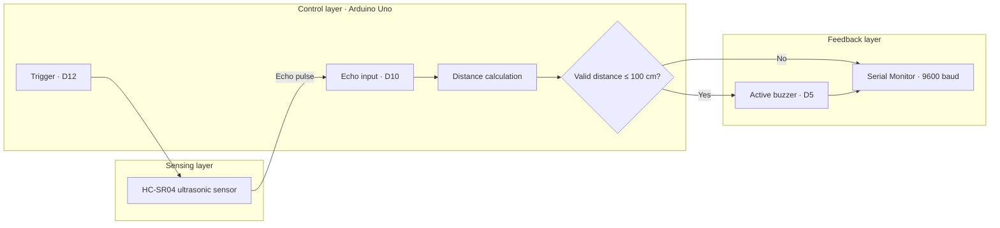
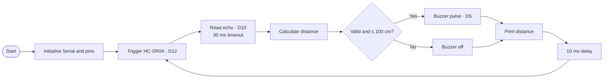

<!-- Third Hand-Eye | Embedded systems project by Supriyo Sarkar -->

<div align="center">

<a href="https://github.com/Supriyo016/Arduino-Uno-Third-Hand-Eye-Project-for-Visually-Impaired-Individuals">

</a>

# 🦯 Third Hand-Eye

### Arduino-based ultrasonic obstacle-alert prototype

**Sense nearby objects · Estimate distance · Provide an audible alert**

<p>
<a href="https://github.com/Supriyo016/Arduino-Uno-Third-Hand-Eye-Project-for-Visually-Impaired-Individuals/actions/workflows/ci.yml"></a>


</p>

<a href="https://www.youtube.com/watch?v=xSJj8tTnAgg"></a>
<a href="docs/project-report.pdf"></a>
<a href="https://github.com/Supriyo016/Arduino-Uno-Third-Hand-Eye-Project-for-Visually-Impaired-Individuals"></a>

<sub>Designed and developed by <a href="https://github.com/Supriyo016"><strong>Supriyo Sarkar</strong></a></sub>

</div>

---

> [!IMPORTANT]
> **Safety and intended use:** Third Hand-Eye is an educational proof-of-concept, not a certified mobility aid. It must never replace a white cane, guide dog, human assistance, or established mobility practices. The current single-sensor design cannot reliably detect every obstacle, stairs, holes, drop-offs, or all surface types. Do not rely on it for independent navigation or safety-critical decisions.

## 🧭 Project overview

**Third Hand-Eye** explores a simple embedded feedback system using an **Arduino Uno**, an **HC-SR04 ultrasonic sensor**, and an **active buzzer**.

The sensor sends an ultrasonic pulse and measures the time taken for its echo to return. The Arduino converts that duration into an approximate distance. When a valid reading falls within the configured **100 cm alert threshold**, the firmware briefly activates the buzzer. Distance readings are also printed to the Serial Monitor for observation and debugging.

The repository includes the Arduino firmware, reusable distance calculation helpers, a circuit diagram, host-side C++ tests, a CI workflow, a demonstration video and the project report.

<div align="center">
<table>
<tr>
<td align="center" width="25%"><h2>📡</h2><strong>Sense</strong><br><sub>Ultrasonic echo</sub></td>
<td align="center" width="25%"><h2>🧮</h2><strong>Measure</strong><br><sub>Distance estimate</sub></td>
<td align="center" width="25%"><h2>🎯</h2><strong>Detect</strong><br><sub>100 cm threshold</sub></td>
<td align="center" width="25%"><h2>🔔</h2><strong>Alert</strong><br><sub>Audible feedback</sub></td>
</tr>
</table>
</div>

## ✨ Key features

- **Ultrasonic distance measurement** using the HC-SR04 sensor.
- **Configurable alert threshold** currently set to 100 cm in firmware.
- **Audible feedback** through an active buzzer connected to Arduino pin D5.
- **Echo timeout handling** using a 30 ms timeout to avoid waiting indefinitely for an echo.
- **Serial monitoring** at 9600 baud for observing distance readings.
- **Reusable C++ helper functions** separated from Arduino-specific hardware code.
- **Host-side unit tests** for distance conversion and alert boundaries.
- **Automated checks** for C++ tests, Arduino Uno sketch compilation and README links.

> [!NOTE]
> The 100 cm value is the firmware's alert threshold, not a guaranteed detection range. Real sensor performance depends on the object, surface, angle, mounting, environment and power conditions.

## 🏗️ System architecture

The system is organised into three connected layers: **hardware**, **firmware execution**, and **alert decision**. The diagrams below describe the current Arduino implementation, not planned features.

### 1. Hardware architecture

The Arduino Uno acts as the controller. It sends a trigger signal to the HC-SR04, measures the returning echo pulse, and drives the active buzzer when the calculated distance meets the alert condition.



| Connection | Arduino Uno | Purpose |
|---|---:|---|
| HC-SR04 TRIG | D12 | Sends the ultrasonic trigger pulse |
| HC-SR04 ECHO | D10 | Reads the returning echo pulse |
| Active buzzer signal | D5 | Produces the audible alert |
| Serial communication | TX/RX over USB | Prints distance readings at 9600 baud |
| Sensor supply | 5V and GND | Powers the HC-SR04 module |

## 2. Firmware execution flow

The Arduino repeats the following sequence inside `loop()`. The echo measurement has a 30,000 microsecond (30 ms) timeout, which prevents the board from waiting indefinitely if no echo arrives.

### Step-by-step execution

<ol>
<li><strong>Initialise the board:</strong> <code>setup()</code> starts Serial communication at 9600 baud and sets the buzzer, trigger and echo pin modes.</li>
<li><strong>Prepare the trigger:</strong> the trigger pin is held LOW briefly to establish a clean pulse.</li>
<li><strong>Transmit the ultrasonic trigger:</strong> the Arduino drives D12 HIGH for 10 microseconds, then returns it to LOW.</li>
<li><strong>Capture the echo:</strong> <code>pulseIn()</code> measures the HIGH duration on D10, with a timeout of 30,000 microseconds.</li>
<li><strong>Calculate distance:</strong> the echo duration is passed to <code>microsecondsToCentimeters()</code>, which returns an approximate distance in centimetres. A missing echo returns zero.</li>
<li><strong>Evaluate the alert condition:</strong> <code>shouldAlert(cm, ALERT_RANGE_CM)</code> returns true only when the distance is valid and is less than or equal to 100 cm.</li>
<li><strong>Drive the buzzer:</strong> when the condition is true, D5 is set HIGH for about 100 ms and then LOW; the code adds a short 10 ms delay.</li>
<li><strong>Send serial output:</strong> the distance value followed by <code>cm</code> is printed for debugging and observation.</li>
<li><strong>Repeat the sensing cycle:</strong> after a short 10 ms delay, the loop returns to the trigger step.</li>
</ol>

### Firmware flow diagram



### 3. Distance calculation and alert logic

The reusable helper in `firmware/third_hand_eye/distance.h` converts echo time into an approximate distance:

```cpp
distance_cm = echo_microseconds / 29 / 2;
```

The division by two accounts for the outward and return journeys of the sound pulse. A zero or negative duration returns zero and represents no valid echo.

The alert predicate is implemented as:

```cpp
cm > 0 && cm <= alertRangeCm
```

The current firmware uses:

```cpp
const long ALERT_RANGE_CM = 100;
```

<details>
<summary><strong>Firmware behaviour at a glance</strong></summary>

| Condition | Distance result | Buzzer behaviour |
|---|---:|---|
| No echo / timeout | 0 cm | Remains LOW |
| Valid reading below 100 cm | Greater than 0 and below 100 | Brief audible pulse |
| Exactly at threshold | 100 cm | Brief audible pulse |
| Above threshold | Greater than 100 cm | Remains LOW |

The buzzer is driven HIGH for approximately 100 ms and LOW for approximately 10 ms when the alert predicate is true. Serial output is printed after the alert check.

</details>

> [!NOTE]
> This diagram describes the existing single-sensor firmware. It does not imply object classification, obstacle avoidance, directional detection, vibration feedback, drop-off detection, or a validated safety system.

## 🔌 Hardware and circuit connections

### Components

| Component | Quantity | Purpose |
|---|:---:|---|
| Arduino Uno | 1 | Main microcontroller |
| HC-SR04 ultrasonic sensor | 1 | Echo-based distance measurement |
| Active buzzer module | 1 | Audible alert |
| Jumper wires | As required | Module connections |
| USB data cable | 1 | Programming and bench testing |
| Suitable power source | As required | Powers the prototype |

### Pin mapping

| Module | Pin | Arduino Uno |
|---|---|---|
| HC-SR04 | VCC | 5V |
| HC-SR04 | GND | GND |
| HC-SR04 | TRIG | D12 |
| HC-SR04 | ECHO | D10 |
| Active buzzer | Signal (+) | D5 |
| Active buzzer | GND (−) | GND |

<div align="center">

<br><sub>Hardware circuit reference · Shown once in this README</sub>
</div>

> [!WARNING]
> **Electrical checks:** Verify the exact voltage and current requirements of the buzzer module. A bare buzzer drawing more current than an Arduino GPIO can safely supply requires a suitable transistor/driver circuit. Check wiring, polarity and power supply connections before turning on the circuit.

## 🧰 Technology and tools

<div align="center">

</div>

| Layer | Technology / component |
|---|---|
| Microcontroller | Arduino Uno |
| Firmware language | C++ |
| Distance sensor | HC-SR04 ultrasonic module |
| Alert output | Active buzzer |
| Hardware interface | Arduino digital I/O |
| Distance measurement | Echo pulse timing with `pulseIn()` |
| Unit testing | Standard C++17 and `assert` |
| Compiler | g++ |
| Embedded compilation | Arduino AVR Boards |
| Continuous integration | GitHub Actions |

## 🚀 Build and upload

### Prerequisites

- Arduino Uno board and USB data cable.
- HC-SR04 sensor and active buzzer connected according to the pin table.
- Arduino IDE or Arduino CLI.
- Arduino AVR board core.

### Option 1 — Arduino IDE

1. Clone or download this repository.
2. Open `firmware/third_hand_eye/third_hand_eye.ino`.
3. Select **Tools → Board → Arduino AVR Boards → Arduino Uno**.
4. Select the correct serial port.
5. Click **Upload**.
6. Open Serial Monitor and set the baud rate to **9600**.

### Option 2 — Arduino CLI

Install the AVR core:

```bash
arduino-cli core update-index
arduino-cli core install arduino:avr
```

Compile the sketch:

```bash
arduino-cli compile --fqbn arduino:avr:uno firmware/third_hand_eye
```

Upload it to the board (replace `<PORT>` with the correct serial port):

```bash
arduino-cli upload --fqbn arduino:avr:uno -p <PORT> firmware/third_hand_eye
```

### Observe the output

Open the Serial Monitor at **9600 baud**. The sketch prints measured distance values in centimetres. For a controlled bench test, position a suitable flat object in front of the sensor and compare the serial reading against a ruler or measuring tape. Observe when the buzzer activates relative to the configured threshold.

This bench test is not a validation of mobility safety.

## 🧪 Testing and quality assurance

The distance conversion and alert decision are separated into `distance.h`. These functions do not depend on Arduino libraries, allowing them to be tested on a desktop computer.

### Run unit tests

With g++ installed, execute:

```bash
g++ -std=c++17 -Wall -Wextra -Werror tests/test_distance.cpp -o test_distance
./test_distance
```

Expected successful output:

```text
all distance tests passed
```

### Test coverage

| Test case | Expected result |
|---|---|
| Zero echo duration | 0 cm |
| Negative echo duration | 0 cm |
| 58 microseconds | 1 cm |
| 5,800 microseconds | 100 cm |
| 29,000 microseconds | 500 cm |
| 0 cm reading | No alert |
| 1 cm reading | Alert predicate is true |
| 100 cm reading | Alert predicate is true |
| 101 cm reading | Alert predicate is false |

### Continuous integration

GitHub Actions runs the following jobs from `.github/workflows/ci.yml`:

| CI job | Validation |
|---|---|
| Host unit tests | Compiles and runs C++17 tests |
| Arduino sketch compilation | Checks compilation for `arduino:avr:uno` |
| Markdown link validation | Checks links in `README.md` |

<div align="center">
<a href="https://github.com/Supriyo016/Arduino-Uno-Third-Hand-Eye-Project-for-Visually-Impaired-Individuals/actions">

</a>
</div>

## 🗂️ Repository structure

```text
Arduino-Uno-Third-Hand-Eye-Project/
│
├── .github/
│   └── workflows/
│       └── ci.yml
│
├── assets/
│   ├── banner.svg
│   └── circuit-diagram.png
│
├── docs/
│   ├── demo-480p.mp4
│   └── project-report.pdf
│
├── firmware/
│   └── third_hand_eye/
│       ├── third_hand_eye.ino
│       └── distance.h
│
├── tests/
│   └── test_distance.cpp
│
└── README.md
```

### Important source files

| File | Description |
|---|---|
| `third_hand_eye.ino` | Sensor trigger, echo measurement, buzzer output and serial logging |
| `distance.h` | Distance conversion and alert predicate |
| `test_distance.cpp` | Host-side tests for distance calculations and threshold logic |
| `ci.yml` | Automated C++ tests, Arduino compilation and README link checks |
| `circuit-diagram.png` | Hardware connection diagram |
| `project-report.pdf` | Project report and documentation |

## 🎥 Recorded demonstration and report

The following is the **recorded demonstration of the physical prototype**. It is separate from the interactive 3D-style browser simulation above.

<div align="center">

<a href="https://www.youtube.com/watch?v=xSJj8tTnAgg">
  
</a>
<br>
<sub>Recorded demonstration preview · Select the image to watch the physical prototype video</sub>

<br><sub>Third Hand-Eye · Recorded physical prototype demonstration</sub>

<br><br>

<a href="https://www.youtube.com/watch?v=xSJj8tTnAgg">Watch on YouTube</a> ·
<a href="docs/demo-480p.mp4">Download local 480p video</a> ·
<a href="docs/project-report.pdf">Read project report</a>

</div>

> [!TIP]
> If GitHub's README renderer does not display the inline MP4 player in your browser, use the YouTube link or open the MP4 file directly.

## ⚠️ Limitations and responsible use

The current design uses one forward-facing ultrasonic sensor and an audible output. It is not a complete navigation solution.

| Limitation | Practical impact |
|---|---|
| Limited field of view | Objects outside the sensor's detection cone can be missed. |
| Surface sensitivity | Soft, angled, narrow or irregular surfaces may return unreliable echoes. |
| No drop-off detection | Stairs, holes and ground-level changes are not reliably detected. |
| No object classification | The system cannot identify object type, height, movement or whether a path is safe. |
| Audible-only feedback | Vibration or tactile feedback is not implemented. |
| No validated redundancy | A missed echo or bad measurement must not be interpreted as a clear path. |
| Environmental variation | Mounting and surrounding conditions can affect readings. |

A real assistive product would require validated sensor coverage, fail-safe behaviour, redundancy, safe enclosure and power design, extensive reliability testing, user-centred evaluation and applicable regulatory assessment.

**Use this project for controlled educational experiments only. Do not depend on it for personal mobility or safety.**

## 🔭 Future development

The following items are possible future research and engineering directions. They are **not implemented in the current prototype**.

- [ ] Evaluate vibration feedback using a suitable motor driver.
- [ ] Study distance-dependent alert patterns.
- [ ] Investigate multi-sensor placement and blind-spot reduction.
- [ ] Improve measurement filtering, calibration and invalid-echo handling.
- [ ] Design a wearable enclosure and robust power system.
- [ ] Expand hardware-in-the-loop and environmental test coverage.
- [ ] Conduct supervised usability and reliability evaluation.

## 📬 Project owner

<div align="center">

<a href="https://github.com/Supriyo016">

</a>

<br>

<a href="https://github.com/Supriyo016"></a>
<a href="https://www.linkedin.com/in/supriyo-sarkar/"></a>
<a href="mailto:supriyo.sarkar016@gmail.com"></a>

<br>
<sub>Computer Science & Engineering · Embedded Systems · Assistive Technology</sub>

</div>

---

<div align="center">

**⭐ If this project helps your learning, consider starring the repository.**

<sub>Educational prototype · Verify the circuit and test in a controlled environment.</sub>

<br><br>


</div>
