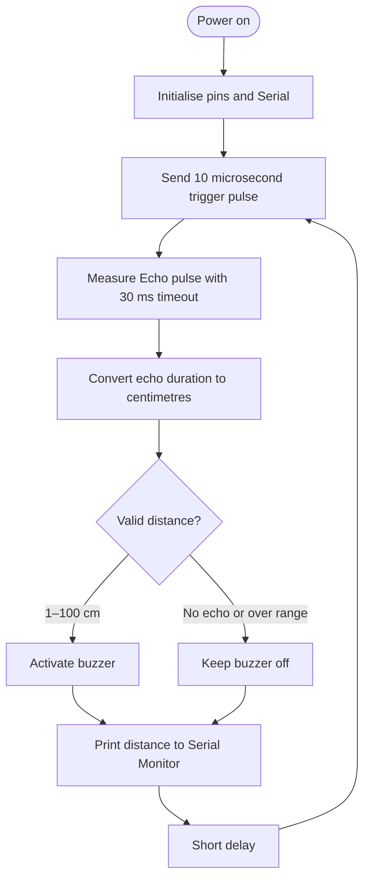

<!-- Third Hand-Eye | Arduino assistive-technology prototype -->

<div align="center">


# 🦯 Third Hand-Eye

### An Arduino-based ultrasonic obstacle-alert prototype

**Sense a nearby obstacle · Trigger an audible alert · Monitor distance readings**

<p>


</p>

<a href="https://github.com/Supriyo016/Arduino-Uno-Third-Hand-Eye-Project-for-Visually-Impaired-Individuals/actions/workflows/ci.yml"></a>
<a href="https://img.shields.io/github/stars/Supriyo016/Arduino-Uno-Third-Hand-Eye-Project-for-Visually-Impaired-Individuals?style=social"></a>
<a href="https://img.shields.io/github/forks/Supriyo016/Arduino-Uno-Third-Hand-Eye-Project-for-Visually-Impaired-Individuals?style=social"></a>

<a href="https://www.youtube.com/watch?v=xSJj8tTnAgg"><strong>▶ Watch demonstration</strong></a> ·
<a href="docs/project-report.pdf"><strong>📄 Project report</strong></a> ·
<a href="#-build-and-upload"><strong>⚙️ Build guide</strong></a>

<sub>Designed and developed by <a href="https://github.com/Supriyo016">Supriyo Sarkar</a></sub>
<br><sub>See also: <a href="https://developerbro.vercel.app">DeveloperBro Academic Portfolio</a> · <a href="https://github.com/Supriyo016/TourIndia/tree/rebuild/nextjs">Tour India</a></sub>
</div>

---

> [!WARNING]
> **Safety and intended use:** This is an educational proof-of-concept prototype, not a certified mobility aid or a replacement for a white cane, guide dog, human assistance or other established mobility methods. It cannot detect every obstacle, surface, drop-off or hazard. Do not rely on it for independent navigation or safety-critical use.

## 📌 Project overview

**Third Hand-Eye** is a low-cost embedded-systems prototype built around an **Arduino Uno**, an **HC-SR04 ultrasonic distance sensor** and an **active buzzer**.

The sensor measures the distance to objects in front of it. When a valid reading is within the configured **100 cm alert range**, the Arduino briefly activates the buzzer. The measured distance is also printed to the Serial Monitor for debugging.

The project demonstrates a complete embedded feedback loop:

1. **Sense** — trigger the ultrasonic sensor and measure the echo duration.
2. **Calculate** — convert the measured pulse time into an approximate distance.
3. **Decide** — check whether the result falls within the configured alert range.
4. **Respond** — sound the buzzer briefly when the condition is met.
5. **Monitor** — print the reading through serial communication.

## ✨ Highlights

<div align="center">
<table>
<tr>
<td align="center" width="50%"><h3>📡 Distance sensing</h3><sub>HC-SR04 ultrasonic echo measurement</sub></td>
<td align="center" width="50%"><h3>🔔 Audible feedback</h3><sub>Active buzzer alert at or below 100 cm</sub></td>
</tr>
<tr>
<td align="center" width="50%"><h3>⏱️ Echo timeout</h3><sub>30 ms timeout avoids a long blocking wait</sub></td>
<td align="center" width="50%"><h3>🧪 Host-side tests</h3><sub>Core distance logic tested with standard C++</sub></td>
</tr>
</table>
</div>

## ⚙️ System workflow



### Distance conversion

The implementation in `firmware/third_hand_eye/distance.h` uses:

```text
distance_cm = echo_microseconds / 29 / 2
```

where the echo duration is measured in microseconds. Division by two accounts for the sound travelling to the object and returning to the sensor.

A timed-out or missing echo is converted to zero and is **not** treated as a valid obstacle measurement.

### Alert logic

```cpp
cm > 0 && cm <= ALERT_RANGE_CM
```

Current threshold:

```cpp
const long ALERT_RANGE_CM = 100;
```

The buzzer is activated briefly when the condition is true.

## 🔌 Hardware requirements

| Component | Quantity | Function |
|---|:---:|---|
| Arduino Uno | 1 | Main controller |
| HC-SR04 ultrasonic sensor | 1 | Forward distance measurement |
| Active buzzer module | 1 | Audible alert |
| Jumper wires | As required | Electrical connections |
| 9 V battery and suitable connector | 1 | Prototype power source |

### Pin mapping

| Module | Pin | Arduino Uno |
|---|---|---|
| HC-SR04 | VCC | 5V |
| HC-SR04 | GND | GND |
| HC-SR04 | TRIG | D12 |
| HC-SR04 | ECHO | D10 |
| Active buzzer | Signal (+) | D5 |
| Active buzzer | GND (−) | GND |

<div align="center">

<br><sub>Third Hand-Eye · Circuit diagram</sub>
</div>

> Verify the exact pin labels and electrical requirements of your buzzer module. A bare buzzer that draws more current than an Arduino GPIO pin can safely supply must use a suitable transistor/driver circuit. Check the power arrangement before connecting a battery.

## 🚀 Build and upload

### Prerequisites

- Arduino Uno board and USB cable
- Arduino IDE **or** Arduino CLI
- Arduino AVR board core

### Option A — Arduino IDE

1. Open `firmware/third_hand_eye/third_hand_eye.ino`.
2. Select **Tools → Board → Arduino AVR Boards → Arduino Uno**.
3. Choose the correct serial port.
4. Upload the sketch.
5. Open Serial Monitor at **9600 baud**.

### Option B — Arduino CLI

Install the AVR core:

```bash
arduino-cli core update-index
arduino-cli core install arduino:avr
```

Compile:

```bash
arduino-cli compile --fqbn arduino:avr:uno firmware/third_hand_eye
```

Upload (replace `<PORT>` with the serial port for your machine):

```bash
arduino-cli upload --fqbn arduino:avr:uno -p <PORT> firmware/third_hand_eye
```

### Observe the output

Open Serial Monitor at **9600 baud**. The sketch prints the measured distance in centimetres. Move a suitable object in front of the sensor and observe the reading and buzzer response.

## 🧪 Testing and continuous integration

The distance conversion and alert predicate are separated from Arduino-specific functions. This allows the logic to be tested with a desktop C++ compiler.

Run the tests with g++:

```bash
g++ -std=c++17 -Wall -Wextra -Werror tests/test_distance.cpp -o test_distance
./test_distance
```

The host test cases cover:
- No echo / timeout handling.
- Time-to-distance conversion.
- The 100 cm alert boundary.
- Readings beyond the alert range.

GitHub Actions runs host tests, checks the Arduino Uno sketch build and validates README links on relevant pushes and pull requests.

## 🗂️ Project structure

```text
Arduino-Uno-Third-Hand-Eye-Project/
├── .github/
│   └── workflows/
│       └── ci.yml
├── assets/
│   ├── banner.svg
│   └── circuit-diagram.png
├── docs/
│   ├── demo-480p.mp4
│   └── project-report.pdf
├── firmware/
│   └── third_hand_eye/
│       ├── third_hand_eye.ino
│       └── distance.h
├── tests/
│   └── test_distance.cpp
└── README.md
```

## 🎥 Demonstration

<div align="center">
<a href="https://www.youtube.com/watch?v=xSJj8tTnAgg">

</a>
<br><strong>▶ Click the preview to watch the project demonstration</strong>
<br><a href="docs/demo-480p.mp4">View the local 480p demonstration clip</a>
</div>

## ⚠️ Limitations and safety considerations

This prototype has a single forward-facing ultrasonic sensor and a buzzer. Its limitations include:

- **Restricted field of view:** objects outside the sensor's narrow detection cone can be missed.
- **Surface sensitivity:** soft, angled or irregular surfaces can produce unreliable echoes.
- **No drop-off detection:** stairs, holes and changes in ground level are not reliably detected.
- **No direction or object classification:** it cannot identify object type, height, movement or safe passage.
- **Audible-only feedback:** the design does not currently provide a vibration or tactile signal.
- **Environmental variation:** sensor readings can be affected by mounting position and surrounding conditions.

Use this device only for controlled educational experiments. Any real-world assistive device would require extensive engineering, field evaluation, redundancy, user testing, fail-safe design and relevant regulatory assessment.

## 🔭 Future improvement ideas

Potential future work—not implemented in the current prototype—includes:
- Add a vibration motor and configurable audio/tactile alerts.
- Vary alert cadence based on measured distance.
- Add additional sensors with carefully validated coverage.
- Improve filtering and invalid-echo handling.
- Design a safe, wearable enclosure and power system.
- Conduct structured usability and reliability testing.

## 📚 Project resources

| Resource | Link |
|---|---|
| Source code | [Repository](https://github.com/Supriyo016/Arduino-Uno-Third-Hand-Eye-Project-for-Visually-Impaired-Individuals) |
| Firmware | [Arduino sketch](firmware/third_hand_eye/third_hand_eye.ino) |
| Circuit | [Circuit diagram](assets/circuit-diagram.png) |
| Report | [Project report PDF](docs/project-report.pdf) |
| Demo | [YouTube demonstration](https://www.youtube.com/watch?v=xSJj8tTnAgg) |
| Workflow | [GitHub Actions CI](.github/workflows/ci.yml) |

## 👨‍💻 Author

<div align="center">
<a href="https://github.com/Supriyo016"></a>
<br>
<a href="https://www.linkedin.com/in/supriyo-sarkar/"></a>
<a href="https://github.com/Supriyo016"></a>
<br><sub>Computer Science & Engineering · Embedded Systems · Assistive Technology</sub>
<br><sub>More projects: <a href="https://developerbro.vercel.app">DeveloperBro</a> · <a href="https://tour-india-pi.vercel.app">Tour India</a></sub>
</div>

---

<div align="center">
<sub>Educational prototype · Verify wiring and test in a controlled environment.</sub>
<br><br>

</div>
